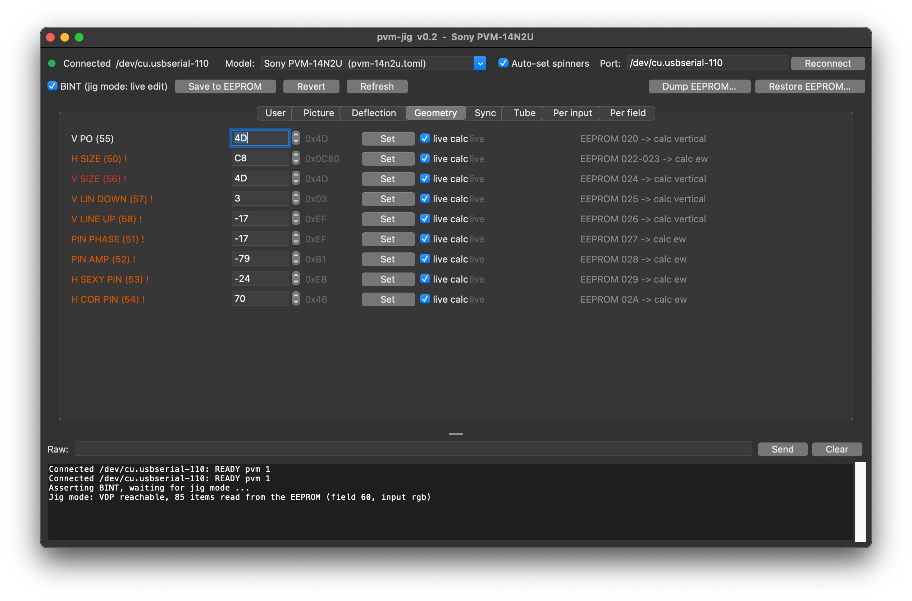

# pvm-jig
[](https://github.com/charlysan/pvm-jig/actions/workflows/build.yml)


Read and adjust the **service settings of Sony PVM monitors** from a computer, through the I2C
service header, using an Arduino Nano.

Geometry, white balance, sub-brightness, sync timing and every other service-menu item can be
changed live on the VDP (if present), saved to the EEPROM, backed up and restored, without opening the service menu.

> **Disclaimer.** This is an experimental hobby project, shared as it is, with no warranty of
> any kind. A CRT monitor has lethal voltages inside, and the service manual warns that the chassis
> can be connected to the AC line. Some service settings (vertical size, beam current, drive levels)
> can damage the tube or the deflection if set wrong. Work at your own risk. The author accepts no
> responsibility for any damage or loss that results.


## Table of contents

- [Supported monitors](#supported-monitors)
- [How it works](#how-it-works)
- [Wiring](#wiring)
- [Quick start guide](#quick-start-guide)
- [Command line](#command-line)
- [Panel](#panel)
- [MiSTer](#mister)
- [Tools](#tools)
- [Adding a monitor](#adding-a-monitor)
- [Using the coding agent skill](#using-the-coding-agent-skill)
- [Documentation](#documentation)
- [Licence](#licence)

## Supported monitors

| Monitor | MCU (firmware) | Video processor | EEPROM | Status |
|---|---|---|---|---|
| PVM-14N2U | CXP85220A-027S (Ver 1.x) | VDP3108 | ST24C04 | service items mapped; geometry exact at 50 and 60 Hz; colour-matrix formula still open |

Each monitor is one model file in `host/models/`. Other PVMs built around a Micronas VDP/VPC
should work the same way once their model file exists.

### Likely compatible (untested)

These share the PVM-14N2U service manual (chassis SCC-H96, SCC-H98, SCC-J34), so the same board
family and jig mode:

- PVM-14N1A, PVM-14N1E, PVM-14N1MDE, PVM-14N1U, PVM-14N2A, PVM-14N2E
- PVM-20N1A, PVM-20N1E, PVM-20N1U, PVM-20N2A, PVM-20N2E, PVM-20N2U
- SSM-14N1E, SSM-14N1U, SSM-20N1E, SSM-20N1U

They are expected to work with the jig, but the model file may not fit as it is: 20" sets have
other factory values (so other safe ranges), N1 models seem to have no RGB input, and Ver 2.x
firmware may store items elsewhere. Check a new unit with an EEPROM dump and `tools/validate.py`
before changing anything.

## How it works

```
  computer ── USB serial ── Nano ── service header (SDA, SCL, BINT, GND)
                                         │
                                    MCU ─┼─ bus 1: EEPROM (settings)
                                         └─ bus 0: VDP (video processor)
```

The monitor's MCU keeps every setting in RAM, sends it to the video processor (VDP) and saves it
to the EEPROM. Pulling the header's **BINT** pin low puts the MCU in **jig mode**: it stops talking
to the VDP and joins both I²C buses, so the header reaches the EEPROM and the VDP.

- **Live:** writes go straight to the VDP and change the picture at once, with no blank.
- **Save:** the same values are written to the EEPROM.
- **Release BINT:** the MCU reloads the EEPROM and re-applies everything (about a 2 s blank).

Some VDP values are calculated by the MCU from several settings. Their formulas live in the model
file; geometry is computed on the host with the MCU's own integer arithmetic and written live.
Brightness, contrast and tint formulas are verified but not live yet: those settings apply when
BINT is released.

## Wiring

The Nano runs at 5 V like the PVM bus, so it connects directly. PVM-14N2U header CN052:

| Nano | CN052 |
|---|---|
| A4 (SDA) | 3 SDA |
| A5 (SCL) | 2 SCL |
| D2 | 4 BINT |
| GND | 1 GND |

Pin 5 (AGING) stays unconnected. Use a 5 V Nano only (classic or Every): 3.3 V boards must not be
used. The USB ground ties the monitor's ground to the computer, so check header GND against the
BNC shells for continuity first.

## Quick start guide

Firmware (Arduino IDE, or `arduino-cli`):

```sh
arduino-cli core install arduino:avr
arduino-cli compile -b arduino:avr:nano:cpu=atmega328old firmware/pvm_jig
arduino-cli upload  -b arduino:avr:nano:cpu=atmega328old -p /dev/tty.usbserial-* firmware/pvm_jig
```

Host (Python 3.9+, pyserial; tomli on Python < 3.11), from the repo:

```sh
python3 -m venv .venv
.venv/bin/pip install -r host/requirements.txt
.venv/bin/python host/pvm-jig.py info
```

You can download latest [release](https://github.com/charlysan/pvm-jig/releases) from the repo. Each GitHub release has:
- `pvm-jig-host-<version>.zip` (the host tools),
- `pvm-jig-mister-<version>.zip` (for a MiSTer, see [mister.md](./mister.md)) and
- `pvm-jig-firmware-<version>.zip` (the compiled hex for the classic Nano, with the sketch; how to flash it
is in its `readme.txt`). 

Unzip the host zip, then `pip install -r pvm-jig/requirements.txt` and run 
```
python3 pvm-jig/pvm-jig.py info
```

Back up the EEPROM before anything else:

```sh
.venv/bin/python host/pvm-jig.py ee dump dumps/eeprom_backup.hex
```

## Command line

```
info / ports            model, port and BINT state / serial ports
bint [on|off|manual|auto]
list [GROUP] [-l]       items with their EEPROM (and VDP) values
get ITEM                one item: value, VDP target, description, safe range
set ITEM VALUE [ITEM VALUE ...] [-c]
                        live write, or EEPROM + reload with -c
pending / commit / discard
ee dump|diff|restore FILE
ee read|write, fp read|write, reg read|write, i2c read|write, scan, raw
shell                   interactive session
```

Values are hex by default; `d:31` is decimal, `osd:28` is the value the monitor's menu shows,
`+N` / `-N` are relative. One `set` can take several items: every value is checked first (a bad
one writes nothing), then they are written with a single reload. The exit code is 1 if a command
failed.

```
$ .venv/bin/python host/pvm-jig.py shell
pvm-jig> set v_cent +10        picture moves down at once
pvm-jig> set h_size +osd:1
pvm-jig> commit                EEPROM written, MCU reloads
```

## Panel

`host/pvm-jig-panel.py` is a Tk GUI over the same library: one tab per group of the model file,
spinners in the menu's own units, a BINT checkbox, Save, Revert, and EEPROM dump / restore.
Risky items are marked, and values outside their safe range ask for confirmation.

```sh
.venv/bin/python host/pvm-jig-panel.py [-p /dev/cu.usbserial-210] [-m pvm-14n2u]
```

<p align="center">
  
  <br>
  <small>pvm jig panel</small>
</p>

## MiSTer

The Nano can also plug into a MiSTer FPGA, which then runs the command line and a web panel
(`host/pvm-jig-web.py`) to adjust the PVM from a phone while a game is on screen. See
[mister.md](./mister.md).

## Tools

| Tool | Does |
|---|---|
| `tools/sr_i2c.py` | Decode sigrok `.sr` captures of both buses and BINT (`--vdp`, `--state`, `--ee-diff DUMP`) |
| `tools/validate.py` | Check an idle capture against an EEPROM dump: every value the model predicts |
| `tools/automap.py` | Change EEPROM bytes, let the MCU reload, show which VDP values move, restore |
| `tools/calcheck.py` | Step each input of a formula and compare with what the MCU writes to the VDP |
| `tools/txn.py` | Decode older text exports (Saleae, sigrok-cli) |
| `tools/build-release.sh` | Build the release zips (host tools, MiSTer) into `dist/`; run by the GitHub workflow on every push and tag |
| `tools/build-firmware.sh` | Build the firmware zip (Nano hex, sketch, readme) into `dist/`; needs arduino-cli |

A logic analyzer (sigrok, fx2lafw) is only needed for mapping a new monitor, not for using the tool.

## Adding a monitor

1. Write `host/models/<model>.toml`: items (EEPROM location, VDP target, encoding), calculated
   values, safe ranges and help texts. The PVM-14N2U file is the example.
2. Map the service items with the procedure in
   [architecture.md, "Mapping a new monitor"](./architecture.md#mapping-a-new-monitor).
3. Keep the captures and dumps in `dumps/<model>/`, and the findings in a register map like
   [register_map.md](./register_map.md).
4. Check the result with `tools/validate.py` and `tools/calcheck.py`.

## Using the coding agent skill

[skill/pvm-mapping/SKILL.md](./skill/pvm-mapping/SKILL.md) points coding agents to the mapping
procedure in `architecture.md`, with the rules they must not skip. It uses the `SKILL.md` format, so
an agent can load it by itself when you talk about mapping or captures; any agent can also follow
it when asked to read the file. To have it load by itself, link it into the agent's skills folder.

For example, in Claude Code, as a project skill:

```sh
mkdir -p .claude/skills
ln -s ../../skill/pvm-mapping .claude/skills/pvm-mapping
```

Start a new session afterwards; the skill shows up as `pvm-mapping`.

## Documentation

- [architecture.md](./architecture.md): design, host library, model file format, test procedures
- [register_map.md](./register_map.md): PVM-14N2U service item <-> EEPROM <-> VDP map, and how it was found
- [mister.md](./mister.md): running on a MiSTer FPGA: install, command line, web panel and its API
- [firmware/readme.txt](./firmware/readme.txt): firmware, serial protocol, wiring
- [skill/pvm-mapping/SKILL.md](./skill/pvm-mapping/SKILL.md): entry point for coding agents

## Licence

MIT. See [LICENSE](./LICENSE).
