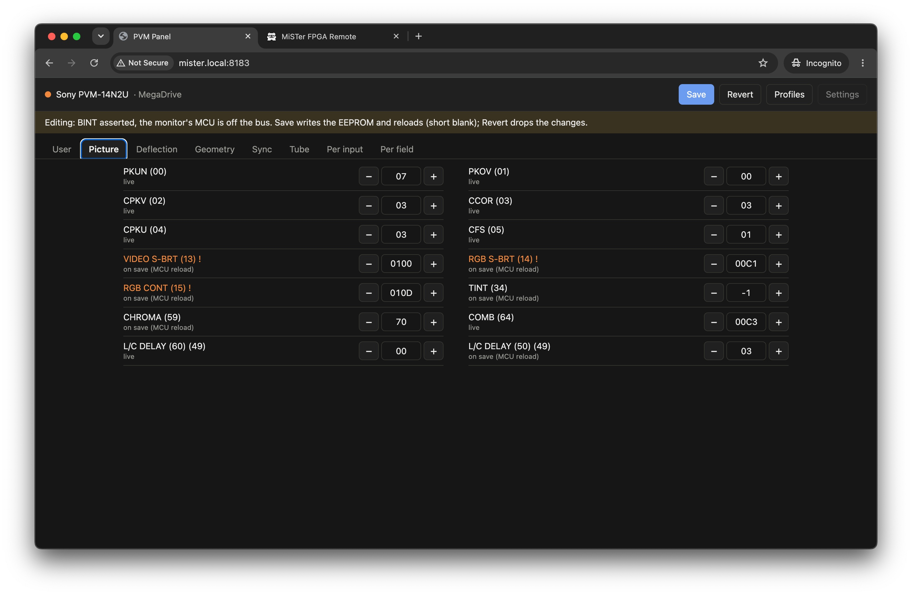
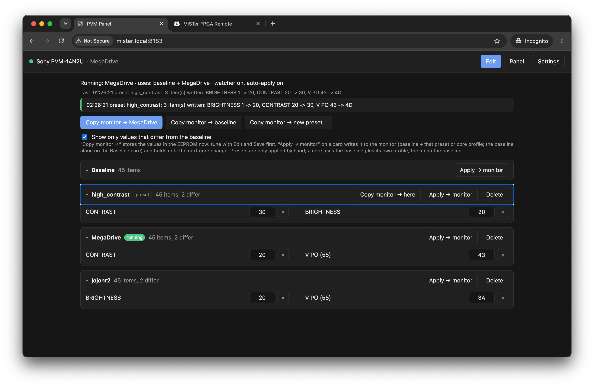

# pvm-jig on MiSTer

The Nano plugs into one of the MiSTer's USB ports and the MiSTer runs the host tools: the command line
over ssh, and a web panel for a phone or computer on the same network. It is all in `host/`, the same
files as on a computer: the web panel (`host/pvm-jig-web.py`, `host/web/`) runs anywhere, and its MiSTer parts
(the running core) simply find nothing elsewhere.

```
computer ── http :8183 ── MiSTer: pvm-jig-web.py ── USB serial ── Nano ── PVM service header
```

## Table of contents

- [Hardware](#hardware)
- [Install](#install)
- [Command line](#command-line)
- [Web panel](#web-panel)
- [Profiles per core](#profiles-per-core)
- [API](#api)
- [Notes and limits](#notes-and-limits)
- [Start at boot](#start-at-boot)

## Hardware

- Same Nano, firmware and wiring as on a computer (see the [README](./README.md#wiring)).
- The CH340 Nano shows up as `/dev/ttyUSB0` (a Nano Every as `/dev/ttyACM0`); the MiSTer kernel has the
  driver. The number can change after an unplug, or with other USB serial devices plugged in.
- The RGB cable already ties the MiSTer and PVM grounds together, so USB adds no new ground path. The
  warning about the chassis possibly being tied to the AC line still applies.

**IMPORTANT NOTE**: always power the Nano (with the Mister) first, and then power on the monitor. And Power off the monitor first, then the Mister.

## Install

pvm-jig ships as one zip, laid out like the SD card:

```
pvm-jig-mister-<version>.zip unzip onto the root of the SD card
├── pvm-jig/                 → /media/fat/pvm-jig
│   ├── pvm-jig.py  pvm-jig-web.py  pvm/  models/  web/
│   ├── serial/  tomli/      bundled packages (pyserial, tomli)
│   └── scripts/             install.sh  uninstall.sh  pvm-jig-web.sh
└── Scripts/
    └── pvm-jig.sh           → OSD Scripts menu (host/scripts/mister-menu.sh)
```

The MiSTer could have Python 3.9 and no pip. The library needs pyserial and, on
Python < 3.11, tomli (instead of `tomllib`), both pure Python and bundled in the zip. With a newer Python,
`tomllib` is used and the bundled tomli is ignored. The zip never contains `pvm-jig-web.json` or
`profiles-*.json`, so unzipping a new version over an old one keeps the settings and profiles.

### With the install script

1. Copy the zip's contents to the root of the SD card: unzip it with the card in a computer, or on the MiSTer:
   `cd /media/fat && unzip pvm-jig-mister-<version>.zip`. The zip is on the project's GitHub releases page.
2. Plug the Nano into the MiSTer.
3. On the MiSTer's OSD: **Scripts > pvm-jig** (or over ssh: `sh /media/fat/pvm-jig/scripts/install.sh`).

The script:
- checks that `python3` loads the library and the bundled packages;
- looks for the Nano (`/dev/ttyUSB*`, `/dev/ttyACM*`), with only a warning if it is missing: the panel
  connects whenever it appears;
- adds the start line to `/media/fat/linux/user-startup.sh` (created from the MiSTer's template if missing;
  a line from an older install with another path is replaced, never duplicated);
- restarts the panel, so an update takes effect, and checks that it is running;
- shows the address to open, e.g. `http://192.168.1.50:8183`.

**Update:** unzip the new version over the old one and run **Scripts > pvm-jig** again.

From an install where the panel was called `pvm-web` (`pvm-web.py` and `pvm-web.sh` in `/media/fat/pvm-jig`),
the install script stops it, deletes those two files and replaces their start line; the panel reads the
old `pvm-web.json` once and saves its settings as `pvm-jig-web.json` from then on (delete the old file
afterwards). The profiles keep their file names.

**Uninstall:** `sh /media/fat/pvm-jig/scripts/uninstall.sh` stops the panel and removes the start line;
the files stay, with the settings and profiles. `uninstall.sh --all` also deletes `/media/fat/pvm-jig` and
the Scripts entry.

### By hand

Copy `pvm-jig/` to `/media/fat/pvm-jig` (from the zip, or built as below), then on the MiSTer:

```sh
cd /media/fat/pvm-jig
python3 pvm-jig.py info                        # READY banner and BINT state
sh scripts/pvm-jig-web.sh start                # web panel on port 8183, log in /tmp/pvm-jig-web.log
```

and add the start line to the boot script as in [Start at boot](#start-at-boot).

### Building the zips

Each release on GitHub has both zips, built by `.github/workflows/build.yml`. To build them yourself, from
the repo root, on a computer with Python 3, pip and zip:

```sh
sh tools/build-release.sh [version]     # default: __version__ in host/pvm/__init__.py
# dist/pvm-jig-mister-<version>.zip   the MiSTer zip above
# dist/pvm-jig-host-<version>.zip     the host tools for a computer (host/ without scripts/)
```

- The MiSTer zip bundles pyserial and tomli, installed with `pip --target ... --python-version 3.9
  --only-binary=:all:` so pip evaluates the tomli marker for the MiSTer's Python, not the computer's. It
  leaves out the Tk panel (needs Tk) and `requirements.txt`.
- The host zip doesn't bundle packages: `pip install -r pvm-jig/requirements.txt`.


## Command line

`pvm-jig.py` works on the MiSTer as on a computer (see the [README](./README.md#command-line)); the port
is found by itself (`/dev/ttyUSB*`, `/dev/ttyACM*`) or given with `-p`. Two features are useful for scripts:

- **Several items in one `set`:** `pvm-jig.py set v_size osd:83 h_size osd:CD`. Every value is parsed and
  range-checked before any is written (a bad one writes nothing), then one commit: one reload, one blank.
- **Exit code:** 1 if a command failed, else 0 (also for commands piped into `shell`, which carries on
  after an error, so prefer one `set` with several items).

Every invocation opens the port, which resets the Nano. That is harmless with BINT released, but the CLI
and the web panel can't use the port at the same time.

## Web panel

`host/pvm-jig-web.py`: a small web server (Python standard library only) that holds one session with the
PVM, as the Tk panel does, and serves `host/web/` (plain HTML, CSS and a small script, no build step).

```sh
python3 pvm-jig-web.py [-p PORT|auto] [-m MODEL] [--listen 0.0.0.0:8183] [--idle 120]
```

Open `http://<mister-ip>:8183`. Or just http://mister.local:8183/ 

<p align="center">
  
  <br>
  <small>pvm jig web profiles</small>
</p>


### Page

- **Top bar:** a dot (green = PVM on, orange = editing, red = Nano not connected; hover for the port and
  the reason), the model, and the core running on the MiSTer (`/tmp/CORENAME`).
- **Edit** asserts BINT (waits for jig mode, as the CLI does) and reads the EEPROM. **Save** writes the
  changed items to the EEPROM and releases BINT (the MCU reloads, short blank). **Revert** releases BINT
  without saving.
- **Tabs:** one per group of the model file; two columns on wide screens, one on a phone. Each item has
  −/+ and a value box in the menu's units (OSD value, decimal or hex, as in the Tk panel). Arrow keys step
  the value, Shift+arrow by 10 (0x10 for hex items). Tap an item's name for its help, risk, safe range and
  EEPROM location.
- **Live vs on save:** live items change the picture at once; the others say "applied on save" and are
  applied by the MCU's reload.
- **Safe ranges:** a value outside the model's safe range asks for confirmation, with the risk text.

### Settings

The **Settings** button sets the serial port and the monitor model. They are kept in `pvm-jig-web.json` next
to `pvm-jig-web.py`; `-p` / `-m` override them at start (`-p auto` forces auto).

- **Auto** (default) picks the first USB serial port each time it connects. When the Nano is unplugged,
  the next status poll fails and drops the link; when it comes back, under any `ttyUSB` number, the next
  poll reconnects. A fixed port is for setups with several USB serial devices.
- **Model:** every `models/*.toml`; switching rebuilds the tabs.
- Both are refused while editing (Save or Revert first). A saved model that no longer exists falls back
  to `pvm-14n2u`.

### Idle timeout

With BINT asserted the MCU is off the bus: it doesn't apply input or line-rate changes or save front-panel
changes. So an edit session must not outlive the page. If no request arrives for `--idle` seconds (default
120), the server reverts and releases BINT, and the page shows a note. The page polls every 3 s, but only
while it is visible, so closing the tab or locking the phone ends the session after the timeout.

## Profiles per core

Profiles are managed apart from Edit: Edit and Save only change the EEPROM, as before. The **Profiles**
button opens their view.

<p align="center">
  
  <br>
  <small>pvm jig web profiles</small>
</p>


- **Baseline:** the settings for the menu and for every core without a profile.
- **Presets:** named snapshots ("bright", "dim", …) applied by hand on any core: baseline + the preset,
  until the next core change. The watcher never applies them by itself.
- **Core profile:** a snapshot for one core (`/tmp/CORENAME`; for arcade cores that is the MRA's setname, so
  in practice one game). A core gets the baseline plus its profile; an item removed from a profile falls back
  to the baseline.
- **Items:** the user group (except `model`, `input` and `prev_input`: change the input with Edit), picture,
  geometry, per input, and `h_cent` / `v_cent` from deflection. Sync, tube, per field and the rest of
  deflection are never in a profile.
- **Copy monitor → `<core>` / → baseline / → new preset…** stores those items from the EEPROM as it is
  now, so tune with Edit and Save first; a preset card also has **Copy monitor → here** to update it. The read is done with BINT released (manual mode), so it doesn't blank the picture.
  The result line says what changed ("jojonr2: V PO 1C -> 1E") or "no change".
- In the list, one card per profile (Baseline, the presets, then each core): expand it to see or change its values (same
  units as the panel, safe range checked), remove an item (×) or delete the profile. "Show only values that
  differ" hides the items equal to the baseline.
- **Apply → monitor** on a card writes that profile now: baseline + that preset or core profile, or the
  baseline alone on the Baseline card, whatever core is running. It holds until the next core change, when the
  watcher (if auto-apply is on) applies the running core's profile again.
- While editing, the copy and apply buttons are disabled.
- Stored in `profiles-<model>.json` next to `pvm-jig-web.py`, one file per monitor model.

### Watcher and auto-apply

Set in **Settings**, kept in `pvm-jig-web.json`:

- **Watch the running core:** a thread that reads `/tmp/CORENAME` every 0.5 s. Off: no thread.
- **Apply profiles automatically:** when the core has been the same for **Delay** seconds (default 1.5), the
  watcher compares the target with the EEPROM, read with BINT released (no blank). If they are the same,
  nothing happens. If not, it asserts BINT (jig check), writes the differing items with the same code as the
  CLI's `set` (so values the MCU stores on SAVE, like the vertical A0, are written too), and releases BINT:
  the MCU reloads (about 2 s blank, mostly hidden by the core's own load).
- The first time auto-apply is turned on, the current EEPROM becomes the baseline (if there is none).
- While editing (BINT asserted), with the PVM off or the Nano unplugged, it doesn't apply and retries every
  3 s, so the profile is applied after Save or Revert, or once the PVM is on. Values outside the safe range
  are never written by auto-apply.
- A Save from Edit stays until the next core change, which applies that core's target. To keep it, save
  it to a profile (or as the baseline).
- The last result ("2 item(s) written: …", "already set", "not applied: …") is shown in the Profiles view.

## API

JSON over HTTP; errors are `{"error": "..."}` with a 4xx/5xx status. All calls to the Nano are serialized.

| Call | Does |
|---|---|
| `GET /api/status` | connection, port (`port_setting`: `auto` or a path), model, core, `pvm` (EEPROM answers, probed with BINT released), `held`, `pending`, context, `note` |
| `GET /api/items` | groups and items of the model: key, title, unit, help, danger, safe range, location, live |
| `GET /api/values` | while editing: every item's value (`raw`, `text` in its units), `live`, `pending` |
| `POST /api/hold` | start editing: assert BINT, wait for jig mode, read the EEPROM; returns the values |
| `POST /api/set` | `{"key", "text", "force"}`: text in the item's units; live write or pending. 409 with `unsafe: true` and the risk text when outside the safe range |
| `POST /api/save` | write pending items to the EEPROM, release BINT |
| `POST /api/revert` | drop pending items, release BINT |
| `GET /api/config` | port setting, auto-detected port, serial ports, model, models, watcher, auto_apply, delay |
| `POST /api/config` | `{"port": "" (auto) or path, "model": id, "watcher", "auto_apply", "delay"}`; 409 while editing |
| `GET /api/profiles` | profile items, baseline, presets, cores, running core, active profile, last apply |
| `POST /api/profiles/capture` | `{"target": "baseline" / "core" / "preset", "name"}`: copy the profile items from the EEPROM (read with BINT released) |
| `POST /api/profiles/set` | `{"preset": name}` or `{"core": name or "" (baseline)}`, plus `"key", "text", "force"` |
| `POST /api/profiles/remove` | profile as above, plus `"key"`: drop one item |
| `POST /api/profiles/delete` | `{"preset": name}` or `{"core": name}` |
| `POST /api/profiles/apply` | `{"preset": name}` or `{"core": name}` = baseline + that profile, `{"core": ""}` = baseline alone, `{}` = the running core's target |

## Notes and limits

- **One program on the port.** While `pvm-jig-web.py` runs, don't use `pvm-jig.py` on the same port: opening it
  resets the Nano and releases BINT.
- **No login:** anyone on the network who can reach port 8183 can use the panel.
- **Auto and other devices:** if auto picks a USB serial device that isn't the Nano, each connection
  attempt waits about 6 s for the banner before giving up (the port is closed again); set a fixed port.
- **Not in the web panel yet** (in the Tk panel): the "live calc" checkbox, EEPROM dump and restore, the
  raw console.
- **Start at boot:** see [Start at boot](#start-at-boot).
- **Always power on the Mister with the Nano first, then the Monitor**

## Start at boot

The install script sets this up. By hand: `scripts/pvm-jig-web.sh` starts and stops `pvm-jig-web.py` in the
background:

```sh
sh /media/fat/pvm-jig/scripts/pvm-jig-web.sh start|stop|restart|status [pvm-jig-web.py arguments]
```

- The log goes to `/tmp/pvm-jig-web.log` (RAM, cleared at each start and at reboot); `tail -f /tmp/pvm-jig-web.log`
  follows the watcher. The pid is in `/tmp/pvm-jig-web.pid`.
- `stop` sends SIGTERM: pvm-jig-web reverts an edit in progress and releases BINT before it exits.
- Use it instead of running `pvm-jig-web.py` by hand, or `start` sees no second copy and opens the port twice.

The MiSTer runs `/media/fat/linux/user-startup.sh` at boot. Create it from the template if it doesn't
exist, then add the start line:

```sh
[ -f /media/fat/linux/user-startup.sh ] || cp /media/fat/linux/_user-startup.sh /media/fat/linux/user-startup.sh
cat >> /media/fat/linux/user-startup.sh <<'EOF'

# pvm-jig web panel
[ -f /media/fat/pvm-jig/scripts/pvm-jig-web.sh ] && sh /media/fat/pvm-jig/scripts/pvm-jig-web.sh start
EOF
```

The Nano may enumerate after the panel starts; with the port on auto, the panel connects as soon as it
appears. Port, model, watcher and auto-apply come from `pvm-jig-web.json`, so set them once from the page.
